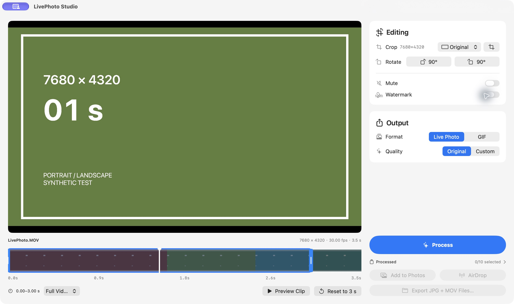
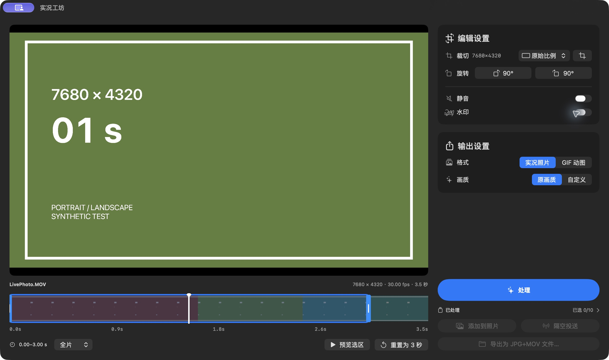
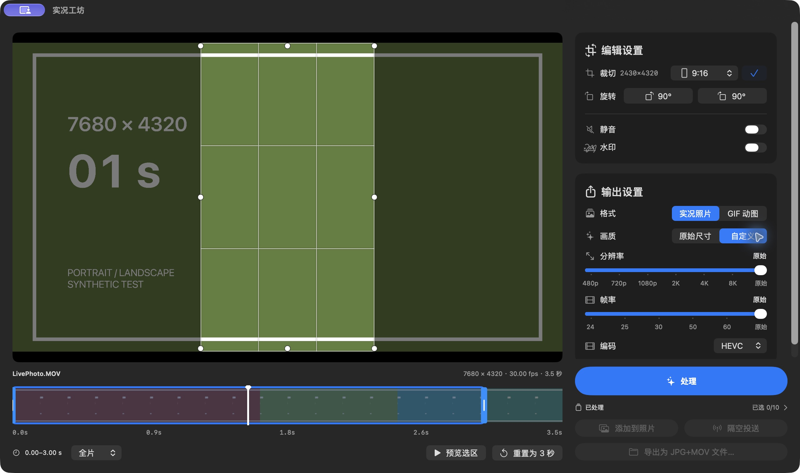
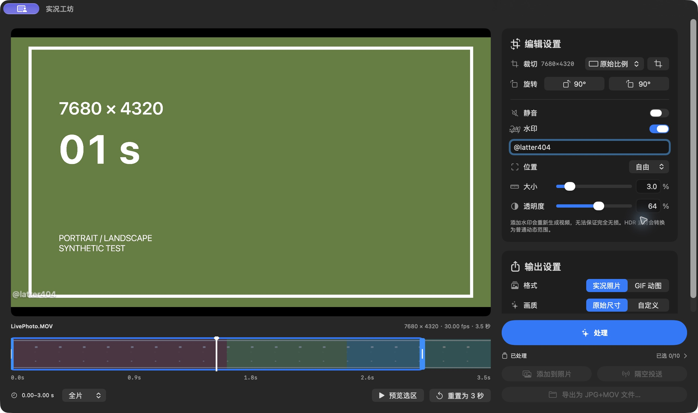

<p align="center"></p>

<h1 align="center">LivePhoto Studio · 实况工坊</h1>

<p align="center">Turn a few favorite seconds into a Live Photo or GIF.</p>

<p align="center"><a href="https://github.com/latter404/LivePhotoStudio/releases/latest">Download</a> · <a href="README.md">简体中文</a> · <a href="RELEASE_NOTES.md">Release notes</a> · <a href="https://github.com/latter404/LivePhotoStudio/issues">Report an issue</a></p>

**macOS 14+ · Apple silicon / Intel · English / Simplified Chinese · MIT licensed**

A native Mac app that processes videos locally. No account or separate FFmpeg, Python, Homebrew, or Xcode installation is needed to use it.



*Actual screenshot of the 1.0 release, using synthetic test footage.*

## More screenshots

### Simplified Chinese · Dark appearance



### Crop and custom output



### Watermarks




## Features

- **Video to Live Photo or GIF:** Select a clip on the timeline, adjust its length and cover, preview, then process. Change the visible timeline range for longer videos.
- **Crop and rotate:** Common landscape and portrait ratios, freeform crop, draggable bounds, and left/right 90° rotation without padding.
- **Watermark and mute:** Custom text, size, opacity, preset positions, or free positioning by dragging.
- **Original size or custom settings:** Resolution and frame-rate sliders, including 4K / 8K size options and 24 / 25 / 30 / 50 / 60 fps options for Live Photos.
- **Create several, share together:** Click **Process** to collect clips, then add selected items to Photos, AirDrop them, or export files in a batch.
- **Mac integration:** Drag and drop, `⌘O`, a top-level Finder context-menu action, first-use guidance, two interface languages, and light/dark appearance.

## Download and get started

1. Download `LivePhotoStudio-1.0-universal.dmg` from [the latest release](https://github.com/latter404/LivePhotoStudio/releases/latest), open it, and drag the app into Applications. Quit the old version before updating.
2. Drop in a video, click the drop area, or press `⌘O`. The default clip is three seconds; move the selection, adjust its ends, and choose a cover frame.
3. Adjust editing and output settings on the right, then click **Process**. Keep creating clips or open **Processed** to select items.

| Goal | Action |
| --- | --- |
| Save to the system photo library | **Add to Photos**, with system permission on first use |
| Send to an iPhone or another supported device | **AirDrop**, then choose the recipient in the system window |
| Save to a folder | **Export Files**: paired JPG + MOV for Live Photos, `.gif` for GIFs |

Files go directly into the chosen folder, without per-item folders or overwriting existing files. Enable the app's Finder extension in System Settings to use the context-menu action.

> The current app is ad-hoc signed and has not been Apple Developer ID signed or notarized. macOS may show a source-verification prompt; follow its interface and your device-management policy.

## Languages and appearance

| Setting | Options |
| --- | --- |
| Interface language | Follow System, Simplified Chinese, English |
| Appearance | Follow System, Light, Dark |

Change these from the **Settings** menu without reimporting the current video. A spotlight guide appears on first use and can be reopened from **Settings → Show Guide**.

## Quality and Live Photo sharing

**The default prioritizes preserving the source video.** With a supported source codec and no actual crop, watermark, or custom output settings, encoded video data is copied without re-encoding. A 90° rotation alone changes orientation metadata.

**Editing the image requires a different processing path.** Cropping, watermarking, and custom output settings re-encode video. This path currently outputs SDR, converting HDR footage to standard dynamic range. GIFs have at most 256 colors and no audio.

**A Live Photo combines a still image and a video.** Keep exported JPG + MOV files together; ordinary file viewers may not support LIVE playback. For an iPhone, use the app's AirDrop action, then confirm the LIVE badge and playback in Photos on the receiving device.

<details>
<summary>Quality, frame-rate, and high-resolution details</summary>

| Settings | Video processing |
| --- | --- |
| Original quality, with no watermark, actual crop, or custom output settings | Copies encoded video data without re-encoding when the source codec supports passthrough. |
| Only a 90° rotation | Changes orientation metadata; rotation alone does not re-encode the video or add borders. |
| Watermark, actual crop, or custom size/frame rate | Re-encodes video. The current processing path outputs SDR, converting HDR footage to standard dynamic range; this is not guaranteed lossless. |
| GIF | Original size and source frame rate by default, capped at 50 fps; at most 256 colors, with no audio. |

The Live Photo cover is generated separately as a high-quality JPEG. The encoded-video preservation statement does not mean the cover is lossless. Passthrough clips may start at an earlier keyframe and run slightly longer than the requested selection. Custom size settings do not upscale smaller footage. Video encoding requires even dimensions, which may trim the crop inward by one pixel.

4K and 8K options do not imply that every device, codec, and output mode has been tested. High-resolution encoding—and especially original-size GIF creation—can take substantial time, memory, and disk space.

</details>

## Processed items and privacy

Previous results are retained but start unselected after relaunch. The Process badge counts only items created during the current app session. Automatic cleanup is off by default; the storage location and cleanup after each delivery action can be configured separately.

<details>
<summary>How selection and the Process badge work</summary>

On each launch, previously processed items remain available but start unselected. Select them in the collection when needed. Newly processed items are automatically added to the current selection, so you can create several and act on them together; existing selections are retained during the same app session.

The red badge on **Process** counts only **items created during this app session that are still available**. It is neither the historical total nor the selection count. It hides at zero and resets on relaunch; the complete history remains in **Processed**. Manually selecting historical items does not increase this badge.

</details>

<details>
<summary>Storage location and cleanup rules</summary>

Processed items are stored under `LivePhotoStudio/Finished` in the current user's Application Support directory by default. These are independent app-managed copies that remain available after relaunch, even if the source video moves.

The collection has no fixed item-count cap and does not evict old items based on their number. Practical capacity depends on disk space and other resources. Loading currently reads metadata item by item, so larger collections may take longer to load. The cleanup rules below are unchanged.

In **Settings → Storage & Cleanup**, you can:

- Choose separately whether to remove processed items after adding to Photos, AirDrop, or file export. **All three options are off by default.**
- Change the storage location and migrate existing items. The app verifies the copies before switching locations, then moves the old copies to Trash.

Cleanup moves only the app's processed items to the system Trash. It does not remove source videos, Photos library assets, or exported files. For Add to Photos and file export, cleanup runs only after the corresponding operation succeeds. Failed or cancelled operations keep the items.

AirDrop works differently. With its cleanup option enabled, the app asks whether the recipient received the items after the system sharing window ends. **Keep Items** is the default; cleanup occurs only if you explicitly choose **Move to Trash**. Closing the window does not prove delivery, so the question may also appear after cancelling AirDrop; choose Keep Items in that case. An explicit failure or cancellation reported by the system does not prompt or remove anything. The app never deletes processed items solely because the sharing window ended, and cannot independently confirm LIVE playback on the receiving device.

</details>

<details>
<summary>Privacy and system permissions</summary>

- Media processing stays on your Mac. The app has no built-in media-upload service, account system, or telemetry service.
- Only the **Add to Photos** and **AirDrop** actions hand selected media to the respective system service. Whether Photos syncs through iCloud is controlled by system settings.
- Processed media, titles, and clip times are stored at the selected location. If you choose a cloud-synced folder, its provider controls that folder's synchronization.
- A bounded local diagnostic log is written to `Library/Logs/LivePhotoStudio/Export.log` in the current user's home directory. It records processing phases, environment, and error information, but not media names, paths, image content, or watermark text. It is not uploaded automatically.

</details>

## Development and feedback

[Open an issue](https://github.com/latter404/LivePhotoStudio/issues) with the app and macOS versions, hardware, input resolution / frame rate, steps to reproduce, and a report with private information removed. A private original video is not required.

All 95 automated tests passed for 1.0. See the [release notes](RELEASE_NOTES.md) for actual device-validation scope. 4K / 8K options do not mean every device, codec, or export path has been tested.

<details>
<summary>Build from source and run tests</summary>

Building requires full Xcode, its macOS SDK, and Python 3. Python is used only to prepare and validate the app bundle; it is not a runtime dependency.

From the source directory:

```sh
zsh build.sh
```

The script builds `arm64` and `x86_64`, combines the universal app and Finder extension, removes absolute development-toolchain search paths, signs the result, and validates the bundle. On success, `实况工坊.app` is written to the parent of the source directory. See the [build script](build.sh), [Swift package manifest](Package.swift), and [bundle validator](validate_package.py).

For manual testing, use `zsh build.sh --test "Crop checks"`. The display name includes **Test**, the version, and the purpose. The bundle is written to `测试版本.noindex/实况工坊-测试版.app` in the parent directory. Remove it after testing. Keep only the current and previous release installers as backups; loose `.app` copies can appear as duplicate applications in macOS.

Run the automated tests with:

```sh
swift test
```

Tests use temporary directories and synthetic media. They cover pairing metadata, rotation and cropping, watermark placement, processed-item persistence, batch sharing preparation, file export, and failure cleanup. Their source is in [Tests](Tests/LivePhotoStudioTests). Passing tests do not establish installation, UI behavior, Photos library writes, or iPhone receipt on every device.

For 1.0, all 95 automated tests passed. Local UI checks covered switching from manual Light/Dark back to Follow System, live macOS appearance changes, and the installed release’s version display. See the [release notes](RELEASE_NOTES.md) for scope and limitations.

</details>

## License and credits

Author: [latter404](https://github.com/latter404).

This project's code is distributed under the [MIT License](LICENSE), with original copyright and license notices retained for incorporated upstream code.

- [Revive](https://github.com/Ed3110/Revive): Portions of the conversion, verification, and test code are based on or adapted from this project; its [MIT copyright and license](Licenses/Revive-MIT.txt) are preserved.
- [makelive](https://github.com/RhetTbull/makelive): Reference for Live Photo sharing packages; its [MIT copyright and license](Licenses/makelive-MIT.txt) are preserved.

Detailed pinned upstream revisions and reuse scope are recorded in [Third-party notices](Licenses/THIRD_PARTY_NOTICES.txt). The project's MIT notice, third-party notices, and both complete upstream licenses are distributed with the source and app, and can be read in **About → Open-source Licenses**.

The retained Revive license includes a separate notice for the Great Vibes font; this app neither uses nor bundles that font. This project does not relicense Apple's system fonts, frameworks, SF Symbols, or product names under MIT. The app icon was created with AI assistance and its provenance is retained; those records do not themselves establish exclusive copyright or trademark rights.
