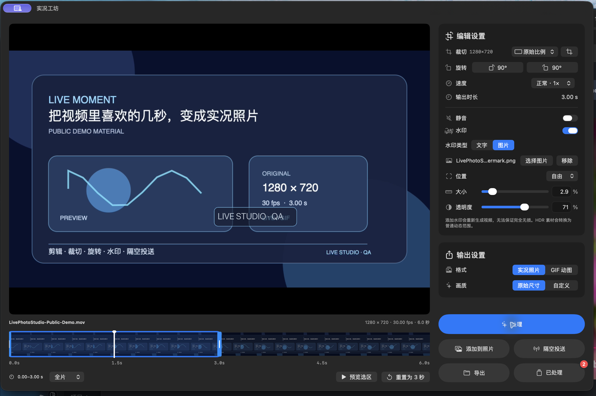
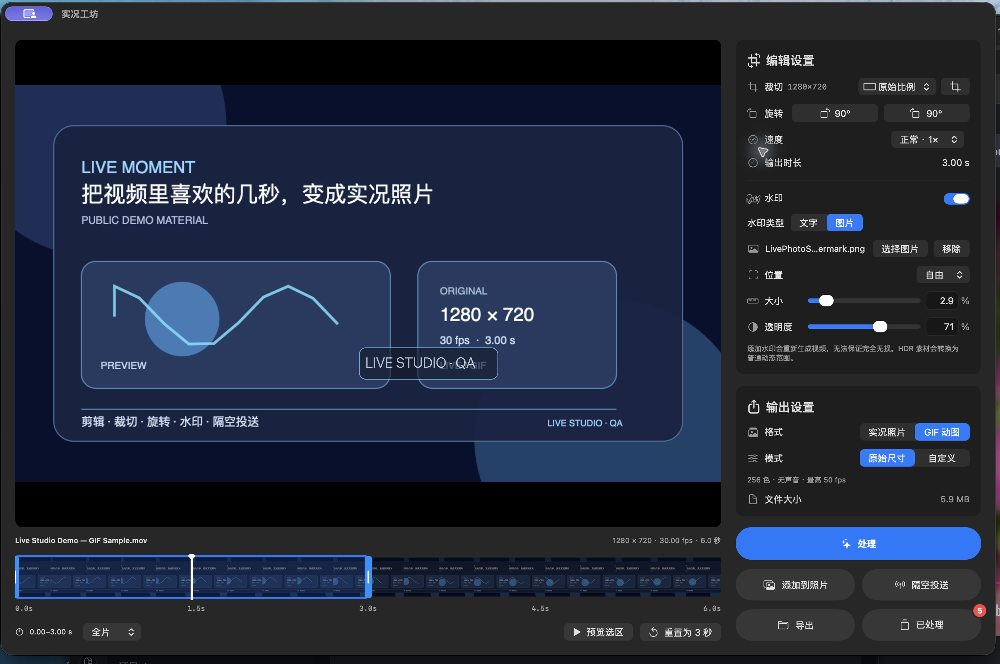
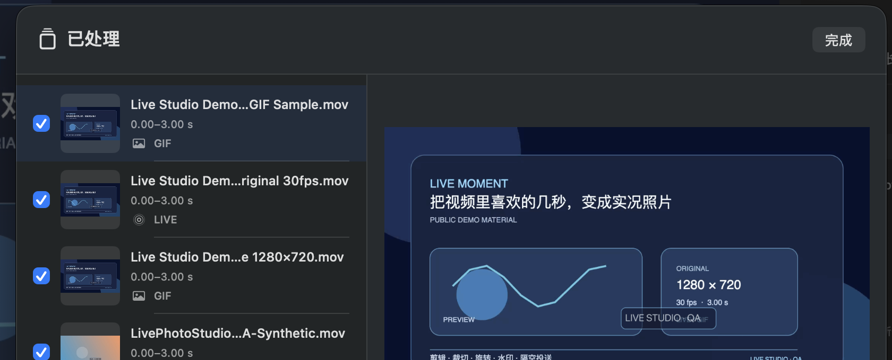

<p align="center"></p>

<h1 align="center">实况工坊 · LivePhoto Studio</h1>

<p align="center">把视频里喜欢的几秒，变成实况照片或 GIF。</p>

<p align="center"><a href="https://github.com/latter404/LivePhotoStudio/releases/latest">下载安装</a> · <a href="README.en.md">English</a> · <a href="RELEASE_NOTES.md">版本说明</a> · <a href="https://github.com/latter404/LivePhotoStudio/issues">反馈问题</a></p>

**macOS 14+ · Apple 芯片 / Intel · 简体中文 / English · MIT 开源**

原生 Mac 应用，在本机完成视频处理。无需账号，也不用额外安装 FFmpeg、Python、Homebrew 或 Xcode 即可使用。

## 1.7 界面展示



*专用合成演示素材，包含应用自带演示水印。*





## 能做什么

- **视频转实况 / GIF**：拖动时间轴选片段、调整时长和封面，预览后处理；长视频支持切换时间轴显示范围。
- **变速与时长**：支持 0.25×、0.5×、1×、1.5×、2×、4×；默认最终播放不超过 3 秒，慢放也不会自动变成 6 秒。拖动选区两端可自定时长，右侧始终显示输出时长。
- **GIF 大小预估**：处理前显示采样估算大小，处理后显示实际大小，方便调整上传体积；预估不是体积保证。
- **裁切与旋转**：常见横竖比例、自由裁切、可拖动选框；左右旋转 90°，不加黑边。
- **水印与静音**：自定义文字、大小、透明度，选择预设位置或自由拖动水印。
- **原始尺寸与自定义参数**：默认使用原始尺寸；用滑条调整分辨率和帧率，提供 4K / 8K 尺寸选项及 24 / 25 / 30 / 50 / 60 fps 实况帧率选项。
- **连续制作，批量操作**：点「处理」累积多个片段，再一起添加到照片、隔空投送或导出文件。
- **适合 Mac 的使用习惯**：拖放导入、`⌘O`、Finder 一级右键入口、首次使用引导，以及中英双语和浅深色外观。

## 下载与上手

1. 在 [最新发布](https://github.com/latter404/LivePhotoStudio/releases/latest) 下载当前安装包，打开后将应用拖入「应用程序」。更新时先退出旧版。
2. 拖入视频，或点击放置框 / 按 `⌘O` 选择文件。默认最终播放不超过 3 秒，可移动选框、调整两端和封面标记。未自定时长时，切换速度会调整原片选区以保持这个默认值；手动拖过任一端后保留你的原片选区，输出时长随速度变化。「重置为 3 秒」恢复默认行为。
3. 在右侧调整画面与输出设置，点击「处理」。继续制作更多片段，或在「已处理」里选择要操作的结果。

| 想做什么 | 选择哪个按钮 |
| --- | --- |
| 保存到系统照片图库 | **添加到照片**，首次使用需要系统授权 |
| 发给 iPhone 或其他支持的设备 | **隔空投送**，在系统窗口选择接收设备 |
| 保存到文件夹 | **导出文件**：实况为配对的 JPG + MOV，GIF 为 `.gif` |

文件直接放在所选目录，不为每张新建文件夹，也不覆盖已有文件。Finder 右键入口需要先在系统设置中启用本应用的 Finder 扩展。

> 当前安装包采用 ad-hoc 签名，尚未完成 Apple Developer ID 签名与公证。首次打开可能出现来源验证提示，请按 macOS 界面提示及设备管理策略处理。

## 语言与外观

| 设置 | 可选项 |
| --- | --- |
| 界面语言 | 跟随系统、简体中文、English |
| 外观 | 跟随系统、浅色、深色 |

从菜单栏「设置」切换；不需要重新导入当前视频。首次使用有高亮引导，也可从「设置 → 使用引导」重新查看。

## 画质与实况分享

**默认优先保留原视频。** 源编码支持直接封装、且未实际裁切、加水印、变速或修改输出参数时，不重新编码视频。仅旋转 90° 通过方向信息完成，不因旋转重编码。

**编辑画面会影响处理方式。** 裁切、水印、变速和自定义参数需要重新编码；当前处理链输出 SDR，HDR 素材会转换为普通动态范围。GIF 受格式限制，最多 256 色且没有声音。

**实况由照片与视频共同组成。** 导出的 JPG + MOV 需要配对使用，普通文件预览器不一定支持 LIVE。发给 iPhone 时，建议使用应用内隔空投送，并在接收端「照片」确认 LIVE 标记与播放效果。

<details>
<summary>展开画质、帧率与高分辨率说明</summary>

| 设置 | 视频处理方式 |
| --- | --- |
| 原画质，未添加水印、未实际裁切、未启用变速或自定义参数 | 在源编码支持直接封装时复制视频编码数据，不重新编码视频。 |
| 仅左右旋转 90° | 修改方向信息，不因旋转重新编码视频或增加黑边。 |
| 水印、实际裁切、变速或自定义尺寸／帧率 | 重新编码；当前处理链输出 SDR，HDR 素材会转换为普通动态范围，不能承诺完全无损。 |
| GIF | 默认原始尺寸、源帧率，最高 50 fps；最多 256 色、没有声音。 |

实况封面是单独生成的高质量 JPEG，不属于「视频编码数据原样复制」的承诺。直接封装会保留解码所需的前置样本，但播放范围按选区裁定；预览与生成使用同一时间范围。变速保留声音音调，不做光流补帧；默认输出帧率随速度调整，最高 240 fps（GIF 最高 50 fps）。GIF 时长按格式精度取整至百分之一秒。自定义尺寸不会将小尺寸素材放大；视频编码所需的偶数尺寸可能使裁切边缘向内取整 1 像素。

4K、8K 选项不代表所有设备、编码和导出模式都已实机验证。高分辨率转码，尤其是原尺寸 GIF，可能明显消耗时间、内存与磁盘空间。

</details>

## 处理结果与隐私

历史结果会保留，重启后默认不勾选；「已处理」角标只统计本次启动后新生成的结果。自动清理默认关闭，保存位置及三种操作后的清理规则可分别设置。

<details>
<summary>已处理列表与角标怎么算？</summary>

每次启动时，历史处理结果仍保留，但默认不勾选；需要操作时在列表中选择。本次运行中新生成的结果会自动加入当前选区，可连续制作后一起操作；已有选择在同次运行内保留。

「已处理」按钮右上角的红色角标只统计**本次应用运行中新生成且仍可用的结果**，不是历史总数或手动勾选数。数量为 0 时隐藏，重启后归零；完整历史仍在「已处理」列表中。手动选择历史结果不会增加此角标。

</details>

<details>
<summary>文件保存在哪里，什么时候清理？</summary>

处理结果默认保存在当前用户的 Application Support 下的 `LivePhotoStudio/Finished` 目录。它们是应用管理的独立副本，重启仍可使用，也不依赖原视频继续留在原位置。

列表没有固定条数上限，也不会按数量自动淘汰旧结果。实际可保留数量受磁盘空间等资源影响；目前载入时逐项读取元数据，较大的列表可能需要更多读取时间。这不改变下面的清理规则。

「设置 → 存储与清理」可以：

- 分别设置添加到照片、隔空投送、导出文件之后是否移除处理结果，**默认全部关闭**。
- 更改保存位置并迁移已有处理结果；新位置副本校验成功后再切换路径，旧副本移到废纸篓。

清理仅将应用内处理结果移到系统废纸篓，不影响原视频、照片图库或导出的文件。添加到照片、导出文件只在对应操作成功后清理，失败或取消时保留。

隔空投送有所不同：开启该选项后，系统投送窗口结束时会询问你是否已经接收成功，默认选择「保留结果」；只有你明确选择「移到废纸篓」才会清理。关闭窗口并不代表发送成功，因此取消投送后也可能看到这次询问，选择保留即可。系统明确报告失败或取消时，不会询问或清理。应用不会仅凭系统窗口结束就删除处理结果，也无法自行确认接收端是否能播放 LIVE。

</details>

<details>
<summary>隐私与系统权限</summary>

- 视频处理在本机进行，应用没有内置媒体上传、账号或遥测服务。
- 只有主动选择「添加到照片」或「隔空投送」时，应用才把选中处理结果交给对应系统服务。照片图库是否使用 iCloud 同步由系统设置决定。
- 处理结果文件及其标题、片段时间保存在选择的本机存储位置。如果选择云盘同步目录，该目录的同步行为由相应服务管理。
- 本地诊断日志位于当前用户的 `Library/Logs/LivePhotoStudio/Export.log`，记录有限的阶段、系统与错误信息，不记录媒体文件名、路径、画面或水印文字，不自动上传。

</details>

## 开发与反馈

遇到问题可提交 [Issue](https://github.com/latter404/LivePhotoStudio/issues)，附上应用与 macOS 版本、机型、素材分辨率 / 帧率、操作步骤及去除私人信息的错误报告。无需公开私人原视频。

当前 1.7 源码已通过 117 项自动测试，另有 1 项可选外部高分辨率测试跳过；具体实机验证范围见 [发布说明](RELEASE_NOTES.md)。4K / 8K 选项不代表所有设备、编码和导出方式均已完成实机验证。

<details>
<summary>从源码构建与运行测试</summary>

构建需要完整 Xcode、其 macOS SDK 和 Python 3。Python 只用于生成应用包信息与验证，不是运行依赖。

在源码目录执行：

```sh
zsh build.sh
```

脚本分别构建 `arm64` 与 `x86_64`，合并通用主程序和 Finder 扩展，移除开发工具链的绝对搜索路径，签名并验证应用包。成功后输出到源码目录的上一级：`实况工坊.app`。实现见 [构建脚本](build.sh)、[Swift 包配置](Package.swift) 和 [应用包验证脚本](validate_package.py)。

需要手动检查测试应用时，使用 `zsh build.sh --test "裁切检查"`。应用显示名称会包含“测试版”、版本号和用途，输出到上一级的 `测试版本.noindex/实况工坊-测试版.app`。测试完成后清理该副本；版本备份只保留当前正式版和上一版的安装包，避免散放的 `.app` 被系统收进应用列表。

运行自动测试：

```sh
swift test
```

测试使用临时目录和合成媒体，覆盖配对元数据、旋转和裁切、水印位置、处理结果保存、批量分享准备、文件导出及失败清理等，源码位于 [Tests](Tests/LivePhotoStudioTests)。自动测试通过不等于完成了所有设备的安装、UI、照片图库和 iPhone 接收验收。

具体发布说明与已知限制见[发布说明](RELEASE_NOTES.md)。

</details>

## 许可与致谢

作者：[latter404](https://github.com/latter404)。

本项目代码采用 [MIT License](LICENSE)，其中复用代码的原作者版权与许可保留。

- [Revive](https://github.com/Ed3110/Revive)：部分转换、验证及测试代码基于或改写自该项目；保留 [MIT 版权及许可](Licenses/Revive-MIT.txt)。
- [makelive](https://github.com/RhetTbull/makelive)：实况分享封装参考；保留 [MIT 版权及许可](Licenses/makelive-MIT.txt)。

详细来源、固定参考版本和复用范围见 [第三方声明](Licenses/THIRD_PARTY_NOTICES.txt)。项目 MIT、第三方说明及两份上游许可全文随源码与应用分发，可在「关于 → 开源许可」阅读。

Revive 上游许可还包含 Great Vibes 字体的单独许可说明，原文完整保留；本应用未使用或打包该字体。Apple 系统字体、框架、SF Symbols 及产品名称不由本项目重新授予 MIT 许可。应用图标由 AI 辅助生成，保留来源记录；来源记录本身不构成排他版权或商标权利的认定。
