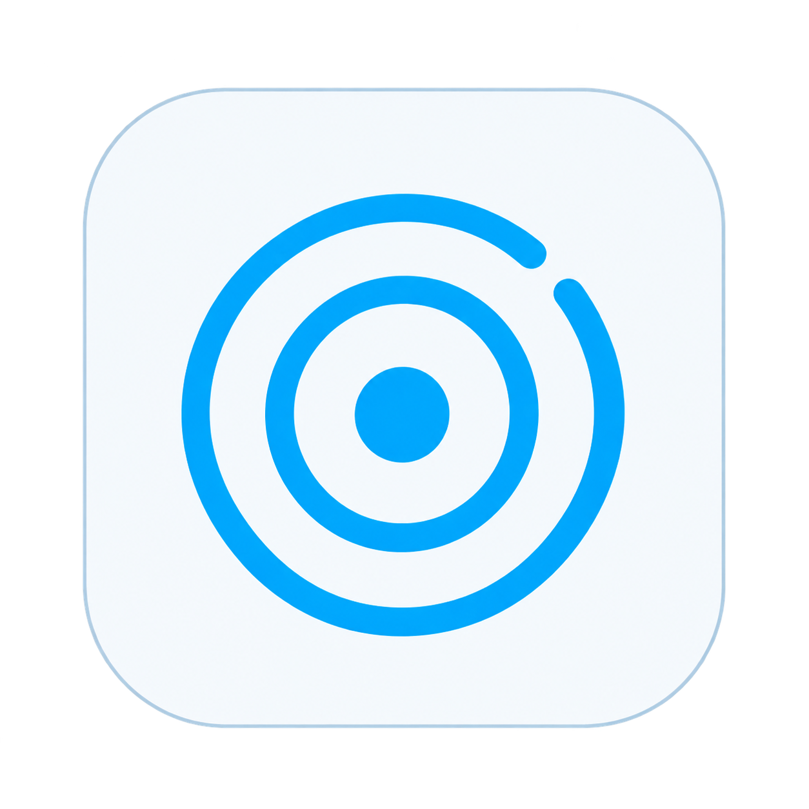
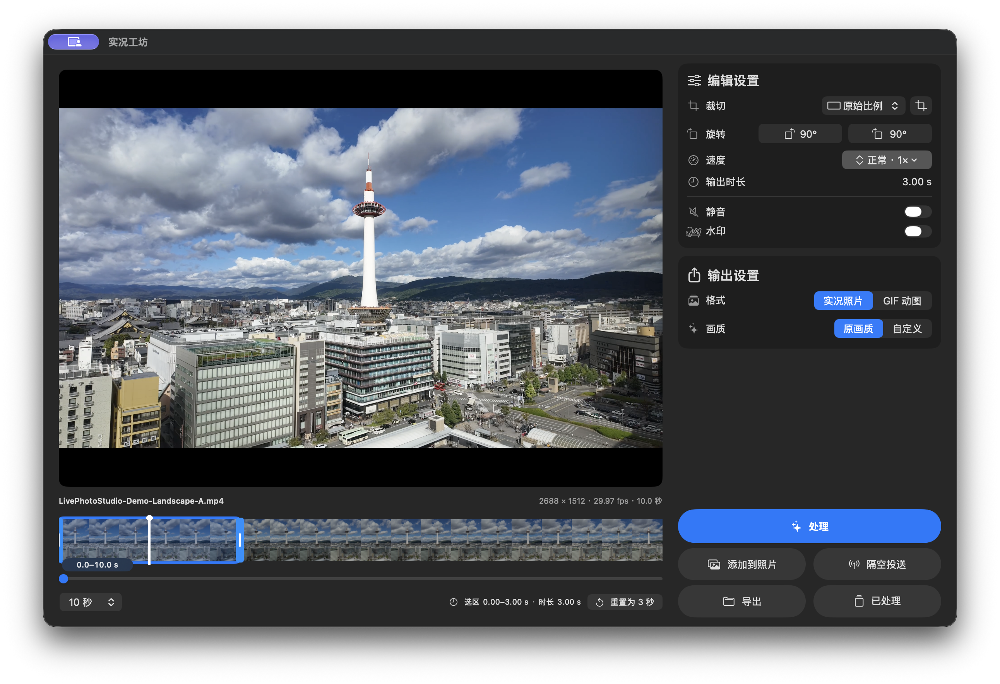
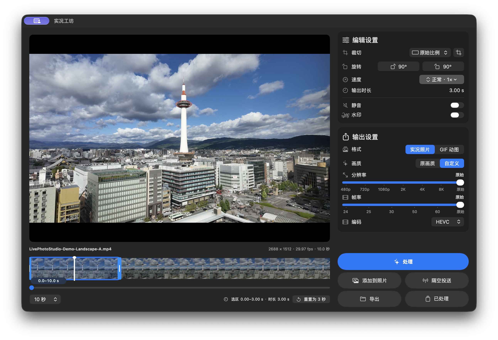
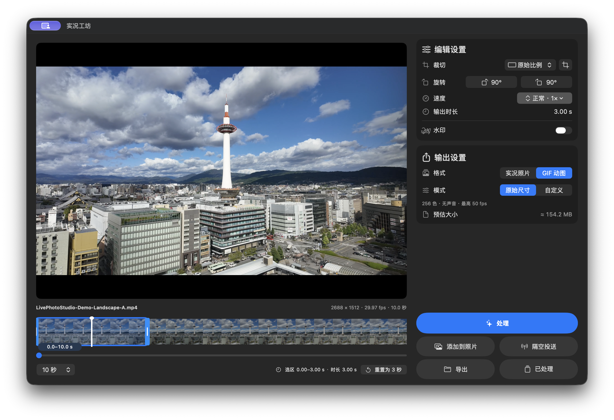
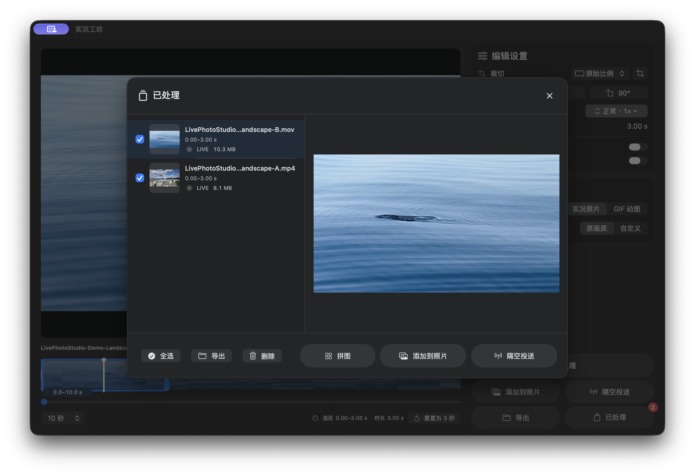
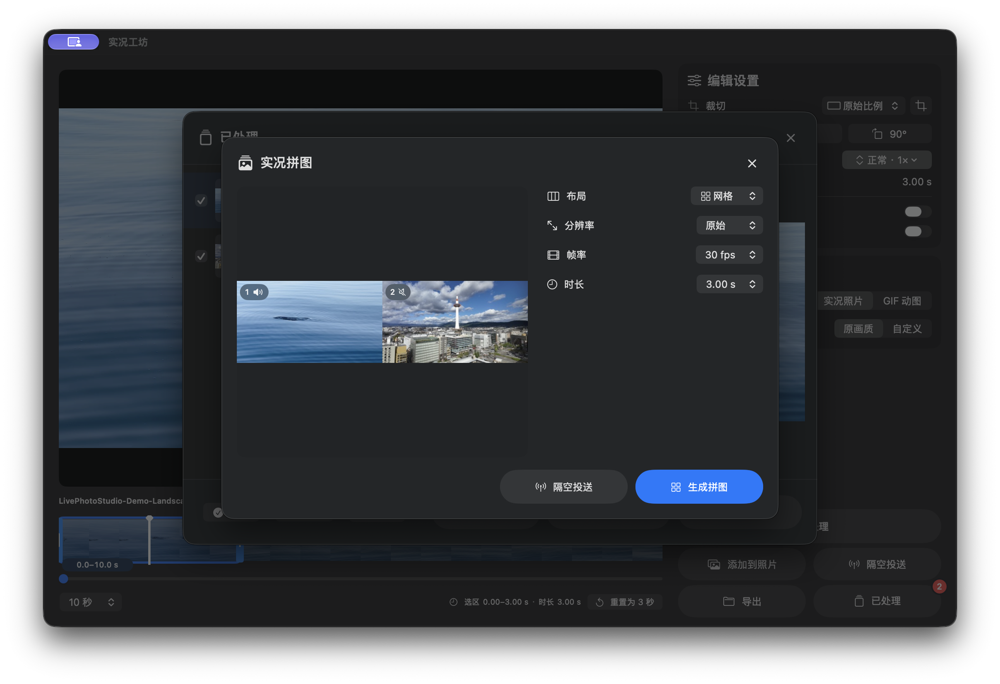

<p align="center"></p>

<h1 align="center">实况工坊 · LivePhoto Studio</h1>

<p align="center">原生 macOS 视频转实况照片与 GIF 工具</p>

<p align="center"><a href="https://github.com/latter404/LivePhotoStudio/releases">下载安装</a> · <a href="README.en.md">English</a> · <a href="RELEASE_NOTES.md">版本说明</a> · <a href="https://github.com/latter404/LivePhotoStudio/issues">反馈问题</a></p>

**macOS 14+ · Apple 芯片 / Intel · 简体中文 / English · MIT 开源**

实况工坊是一款原生 macOS 应用，用视频片段制作实况照片或 GIF。处理默认在本机完成，运行时不需要额外安装 FFmpeg、Python、Homebrew 或 Xcode。

## 功能展示











## 能做什么

- **视频转实况照片或 GIF**：拖动时间轴选择片段、设置封面，处理前直接预览。
- **默认三秒与自定义时长**：默认播放时长控制在 3 秒以内，也可以拖动选区两端自定义时长。
- **变速与 GIF 体积预估**：支持 0.25×、0.5×、1×、1.5×、2×、4×；GIF 处理前显示体积预估，处理后显示实际大小。
- **裁切与旋转**：支持常见横竖比例和自由裁切；支持左右旋转 90°，不增加黑边。
- **水印与静音**：支持文字、图片水印，可调整大小、透明度并直接拖动位置；也可以静音。
- **原始尺寸与自定义参数**：默认保留原始尺寸，可通过滑条调整分辨率和帧率，提供 4K / 8K 以及 24 / 25 / 30 / 50 / 60 fps 选项。
- **连续制作与批量操作**：连续点击「处理」累积多个片段，在「已处理」中多选、删除、导出、添加到照片、隔空投送或制作拼图。
- **拼图与声音选择**：支持直接拖动排序，可选择保留哪一张实况照片的声音，并保留实况照片结构。
- **Mac 使用习惯**：支持拖放、`⌘O`、Finder 一级右键入口、首次使用引导、中英文界面和浅色／深色外观。

## 下载与安装

1. 在 [Releases](https://github.com/latter404/LivePhotoStudio/releases) 下载对应版本的安装包。
2. 解压后将「实况工坊.app」拖入「应用程序」。更新前先退出旧版本。
3. 当前发布包为 ad-hoc 签名，尚未使用 Apple Developer ID 签名与公证；首次打开可能出现来源验证提示。

拖入视频，或点击放置框／按 `⌘O` 选择文件。右侧调整画面与输出设置，点击「处理」。多个片段完成后，从「已处理」进入批量操作。

| 目的 | 操作 |
| --- | --- |
| 保存到照片图库 | **添加到照片** |
| 发给其他设备 | **隔空投送** |
| 保存到文件夹 | **导出**：实况照片为配对的 JPG + MOV，GIF 为 `.gif` |

导出文件直接放在所选目录，不为每张结果创建单独文件夹，也不会覆盖已有文件。Finder 右键入口需要在系统设置中启用本应用的 Finder 扩展。

## 画质与输出说明

- 未实际裁切、未加水印、未变速且未修改输出参数时，源编码支持的情况下会优先直接封装视频数据。
- 裁切、水印、变速和自定义尺寸／帧率需要重新编码；当前处理链输出 SDR，HDR 素材会转换为普通动态范围，因此不能承诺完全无损。
- 仅旋转 90° 时通过方向信息处理，不增加黑边。
- GIF 最多 256 色、没有声音；原尺寸高分辨率 GIF 可能消耗更多时间、内存和磁盘空间。
- 实况照片由一张静态照片和一段视频组成。导出的 JPG + MOV 需要配对使用；普通文件预览器不一定显示 LIVE。

默认处理在本机完成。只有用户主动点击「添加到照片」「隔空投送」或「导出」时，结果才会交给对应系统功能或写入用户选择的位置。

## 语言与外观

| 设置 | 可选项 |
| --- | --- |
| 界面语言 | 跟随系统、简体中文、English |
| 外观 | 跟随系统、浅色、深色 |

从菜单栏「设置」切换；首次使用会显示重点功能引导，也可以从「设置 → 使用引导」重新查看。

## 验证范围

当前源码自动测试：118 项通过、1 项可选高分辨率夹具跳过、0 项失败。

- 自动测试覆盖 Live Photo 配对元数据、时间范围、变速、GIF 估算、裁切、旋转、水印、批量结果、文件导出和失败清理。
- 构建流程检查 Apple 芯片／Intel 通用包、Finder 扩展、签名、资源和运行依赖。
- 截图用于展示界面，不替代完整的设备兼容性验证。
- 4K / 8K 选项代表应用提供对应输出路径，实际耗时和可用性取决于素材、编码器、内存和磁盘空间。

## 开源许可与第三方声明

作者：[latter404](https://github.com/latter404)。本项目代码采用 [MIT License](LICENSE)。

- [Revive](https://github.com/Ed3110/Revive)：部分转换、验证和测试代码基于或改写自该项目，保留其 MIT 版权与许可。
- [makelive](https://github.com/RhetTbull/makelive)：实况分享封装参考，保留其 MIT 版权与许可。

详细来源和固定参考版本见 [第三方声明](Licenses/THIRD_PARTY_NOTICES.txt)。完整许可文件随源码和应用提供，可在「关于 → 开源许可」中查看。Apple 系统框架、SF Symbols、产品名称和应用图标不由本项目重新授予 MIT 许可。

## 从源码构建

构建需要完整 Xcode、macOS SDK 和 Python 3；Python 仅用于生成和验证应用包，不是运行依赖。

```sh
zsh build.sh
swift test
```

测试入口位于 [Tests](Tests/LivePhotoStudioTests)。
