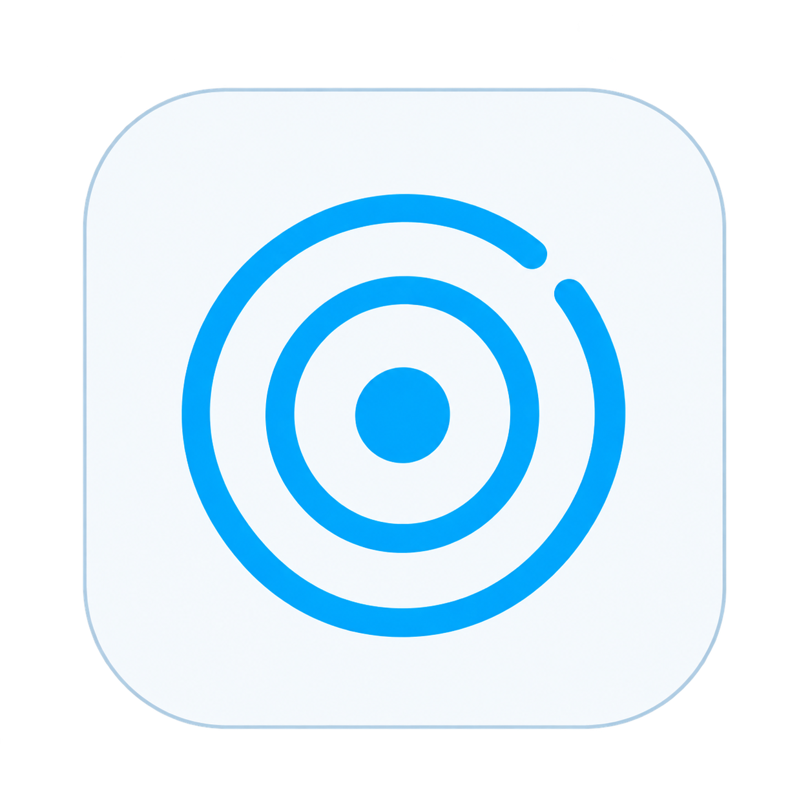
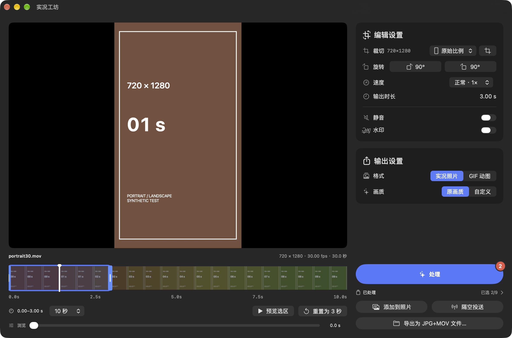
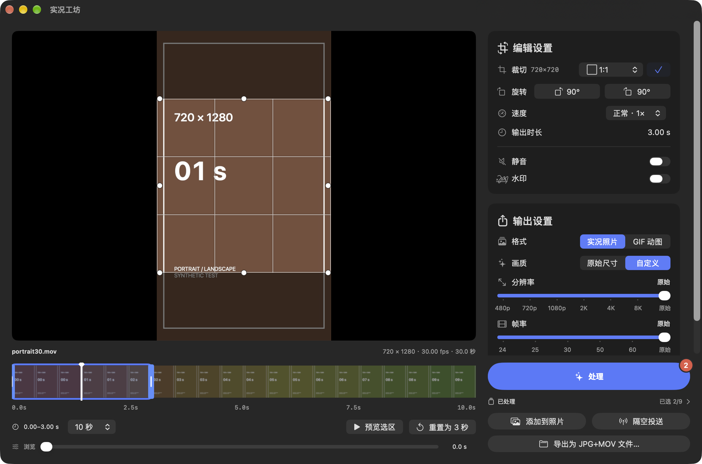
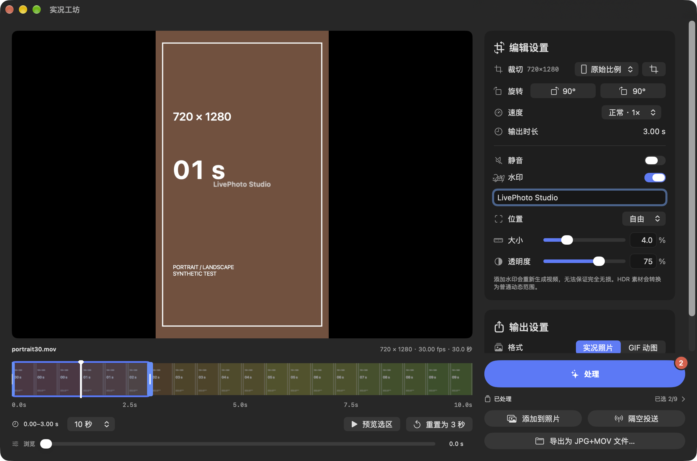
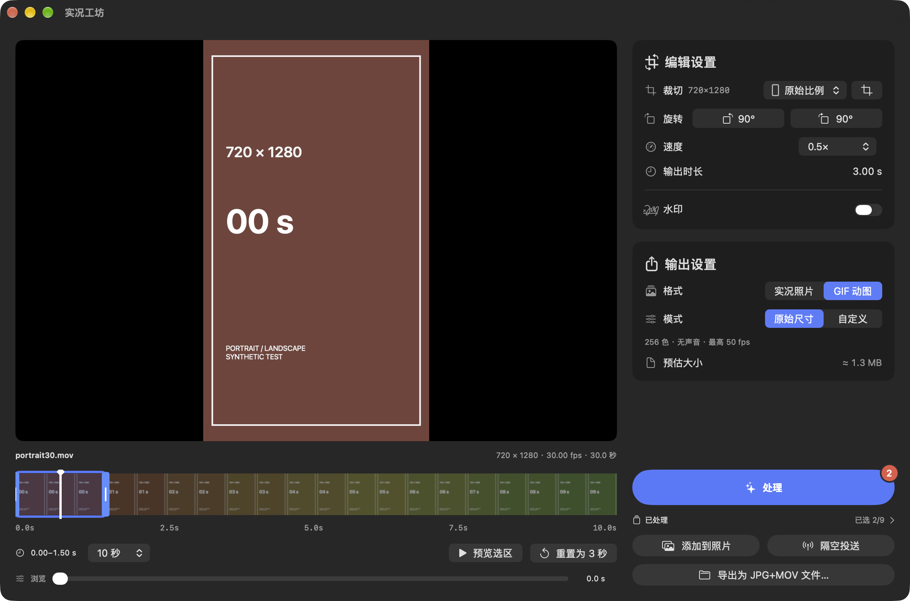
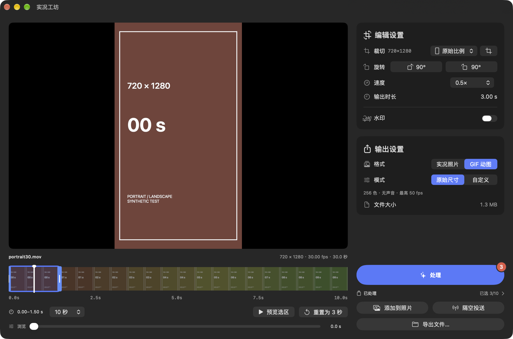
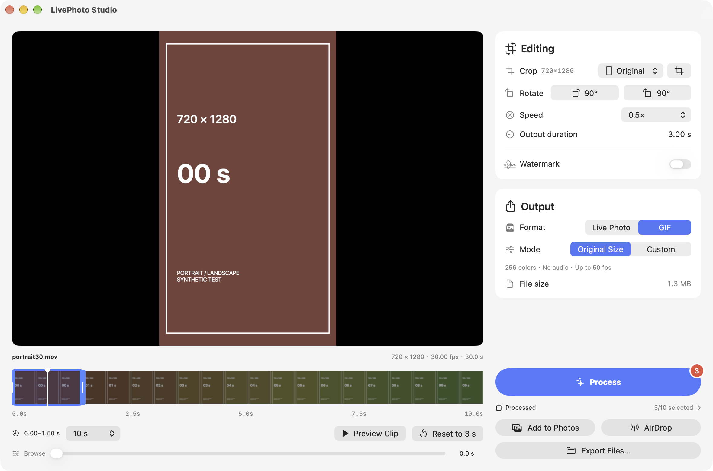

<h1 align="center">实况工坊 · LivePhoto Studio</h1>

<a href="https://github.com/latter404/LivePhotoStudio/releases/tag/v1.1">下载安装</a> · <a href="README.en.md">English</a> · <a href="RELEASE_NOTES.md">版本说明</a>

**macOS 14+ · Apple 芯片 / Intel · 简体中文 / English · MIT 开源**

1.1 在初始版本基础上加入变速、精确时长和 GIF 体积预估。

## 本版功能

- 时间轴两端拖动预览对应画面，并按选区控制输出范围
- 0.25×–4× 播放速度，默认最终时长不超过 3 秒
- 拖动两端自定义时长，「重置为 3 秒」恢复默认
- GIF 处理前采样体积预估，处理后显示实际大小
- 「关于」中的 GitHub 项目链接和完整语言切换

## 下载与安装

下载 [LivePhotoStudio-1.1-universal.dmg](https://github.com/latter404/LivePhotoStudio/releases/download/v1.1/LivePhotoStudio-1.1-universal.dmg)，退出旧版后将应用拖入「应用程序」。支持 macOS 14+、Apple 芯片与 Intel；当前包为 ad-hoc 签名，尚未使用 Apple Developer ID 签名与公证。

## 验证范围

自动测试覆盖精确剪切、首尾帧、直接封装、变速、声音、GIF 时长与体积、默认三秒、手动时长、短素材、历史存储、取消和错误恢复。公开截图使用合成媒体，不包含个人文件名、路径或设备信息。

## 功能截图

