# 实况工坊版本说明

本文件记录已经公开发布的版本，按「更新内容、下载与安装、验证范围、界面截图」整理。

## 1.7.1 · 拼图、批量处理与界面引导

### 更新内容

- 新增实况拼图：支持 2–9 张实况照片、拖动排序、选择保留声音的照片、网格预览，以及分辨率、帧率和时长设置。
- 「已处理」支持多选、全选／取消全选、拼图、导出、删除，以及批量添加到「照片」和隔空投送。
- 主界面继续支持时间轴选区、封面选择、常见比例与自由裁切、左右 90° 旋转、静音、文字水印、GIF 和实况照片输出。
- 输出设置保留原始尺寸优先，并支持自定义分辨率、24／25／30／50／60 fps、H.264 和 HEVC。
- 对无法直接封装的源编码，自动切换到高质量转码流程，并在处理前保留清晰的输出模式提示。
- 主要操作区增加一次性重点功能引导，帮助第一次使用时快速找到处理、批量操作和拼图入口。
- 优化主界面和拼图界面的信息层级、按钮对齐、底部操作区和预览交互。

### 下载与安装

- 下载 [LivePhotoStudio-1.7.1.zip](https://github.com/latter404/LivePhotoStudio/releases/download/v1.7.1/LivePhotoStudio-1.7.1.zip)，解压后将「实况工坊.app」拖入「应用程序」。源码包为 [LivePhotoStudio-1.7.1-source.zip](https://github.com/latter404/LivePhotoStudio/releases/download/v1.7.1/LivePhotoStudio-1.7.1-source.zip)，校验值见 Release 附件中的 `SHA256SUMS.txt`。
- 支持 macOS 14+、Apple 芯片与 Intel；运行不需要额外安装 FFmpeg、Python、Homebrew 或 Xcode。
- 当前包为 ad-hoc 签名，尚未使用 Apple Developer ID 签名与公证；首次打开可能出现 macOS 来源验证提示。

### 验证范围

- `swift test --quiet`：118 项通过、1 项跳过、0 项失败。
- 正式包完成 universal arm64／x86_64 构建、应用包审计、资源检查和安装验证。
- 验证覆盖横向与竖向视频、时间轴选区、实况照片与 GIF 输出设置、已处理列表、原生预览和实况拼图界面。

### 界面截图

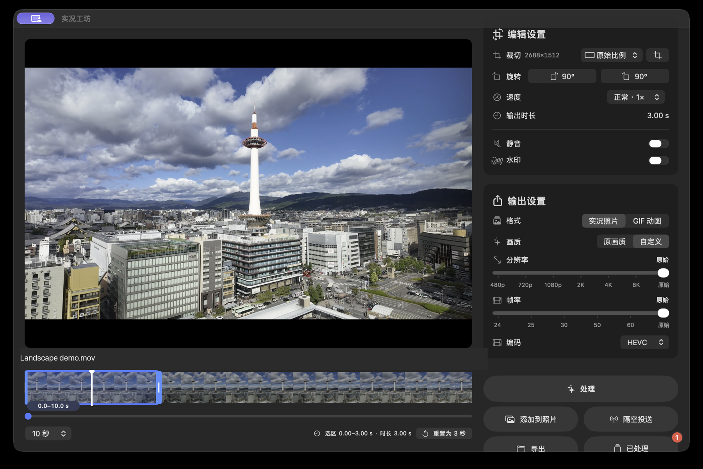

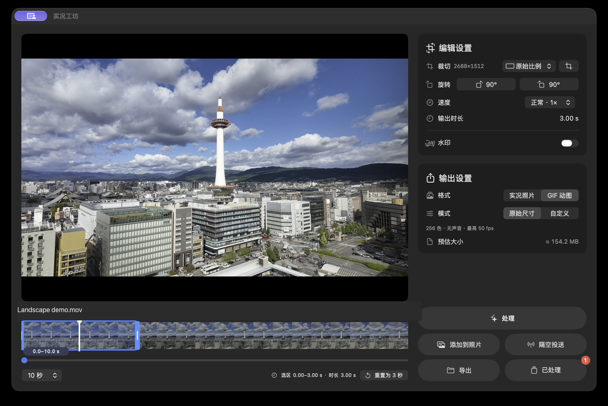

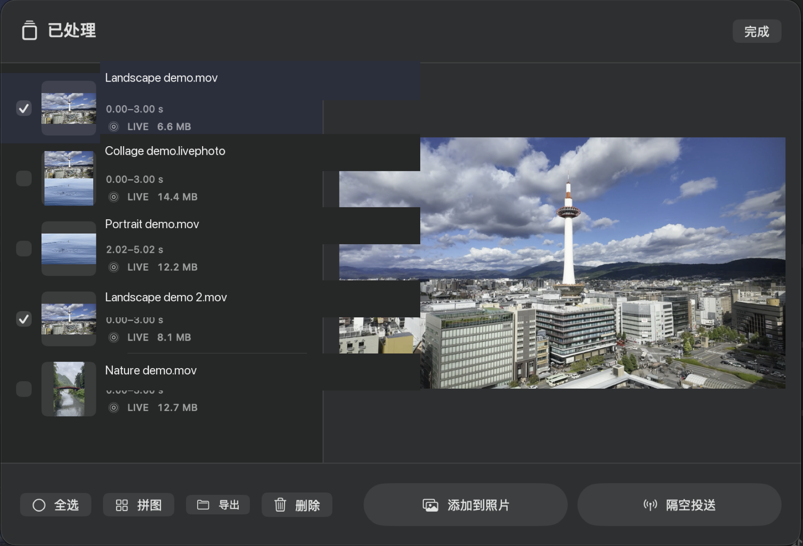

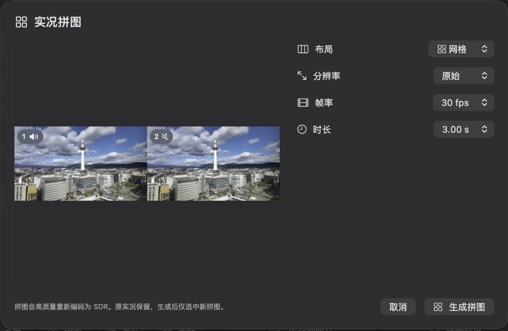

## 1.7 · 拼图、批量处理与界面整理

### 更新内容

- 主页将「处理」「添加到照片」「隔空投送」「导出」和「已处理」分成清晰的操作层级。
- 「已处理」支持全选、拼图、导出所选、删除，以及批量添加到照片和隔空投送。
- 拼图支持直接拖动图片排序，并可指定保留哪一张图片的声音。
- 图片水印支持直接拖动，调整大小和透明度，并改善预览响应。
- 保留视频剪辑、裁切、旋转、静音、文字水印、GIF、帧率、分辨率和 Finder 一级右键入口。

### 下载与安装

- 下载 [LivePhotoStudio-1.7.zip](https://github.com/latter404/LivePhotoStudio/releases/download/v1.7/LivePhotoStudio-1.7.zip)，解压后将「实况工坊.app」拖入「应用程序」。
- 支持 macOS 14+、Apple 芯片与 Intel；运行不需要额外安装 FFmpeg、Python、Homebrew 或 Xcode。
- 当前包为 ad-hoc 签名，尚未使用 Apple Developer ID 签名与公证；首次打开可能出现 macOS 来源验证提示。

### 验证范围

- 自动测试覆盖 Live Photo 配对元数据、时间范围、变速、GIF 估算、裁切、旋转、水印、批量结果、文件导出和失败清理。
- 通用构建流程检查 Apple 芯片／Intel 包、Finder 扩展、签名、资源和运行依赖。
- 公开截图覆盖编辑器、输出设置、已处理列表和实况拼图界面；4K / 8K 选项不等同于所有素材组合都经过完整导出验证。

### 界面截图

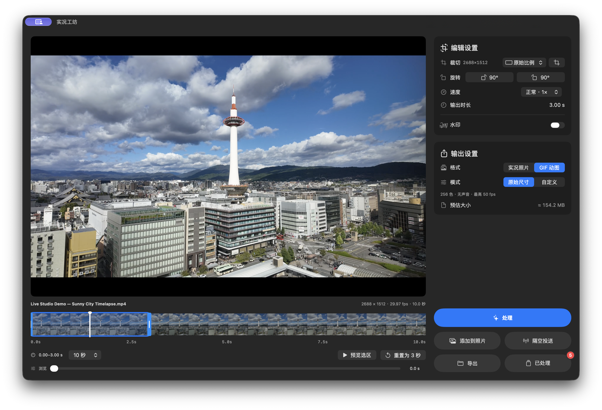

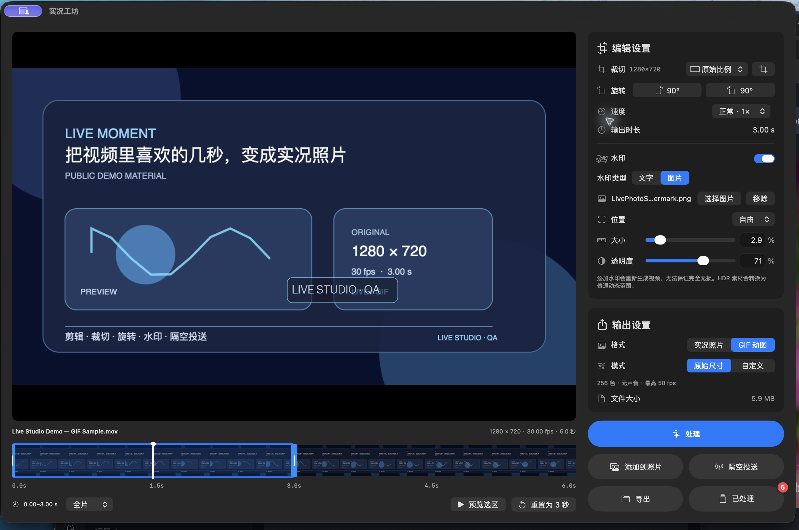

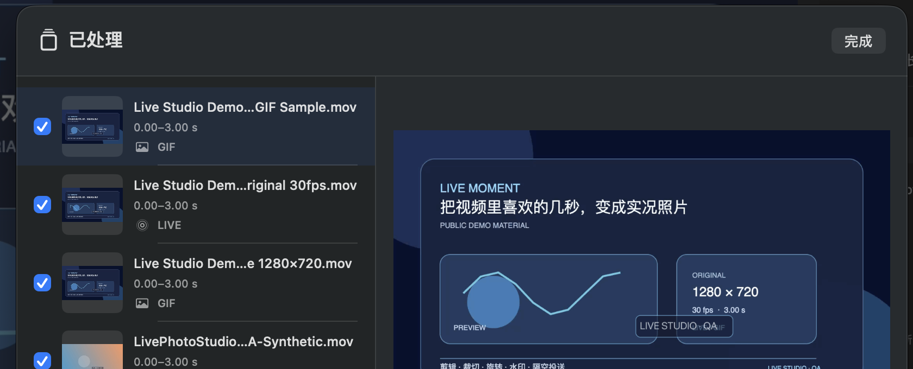

## 1.1 · 变速、精确时长与 GIF 体积预估

### 更新内容

- 时间轴两端拖动都会预览对应画面，直接封装按选区控制播放范围。
- 新增 0.25×–4× 播放速度；默认最终播放时长不超过 3 秒。
- 拖动选区两端可以自定义时长；「重置为 3 秒」恢复默认行为。
- GIF 处理前显示采样体积预估，处理后显示实际大小。
- 「关于」加入 GitHub 项目链接，并修复菜单语言切换后的显示问题。

### 下载与安装

- 下载 [LivePhotoStudio-1.1-universal.dmg](https://github.com/latter404/LivePhotoStudio/releases/download/v1.1/LivePhotoStudio-1.1-universal.dmg)，退出旧版后将应用拖入「应用程序」。
- 支持 macOS 14+、Apple 芯片与 Intel；运行不需要额外安装 FFmpeg、Python 或 Homebrew。
- 当前包为 ad-hoc 签名，尚未使用 Apple Developer ID 签名与公证。

### 验证范围

- 自动测试覆盖精确剪切、首尾帧、直接封装、变速、声音、GIF 时长与体积、默认三秒、手动时长、短素材、历史存储、取消和错误恢复。
- 公开界面截图覆盖中文深色、英文浅色、裁切、自定义输出、水印、GIF 体积预估和处理后大小。
- 验证使用可复现的媒体和本地构建流程。

### 界面截图

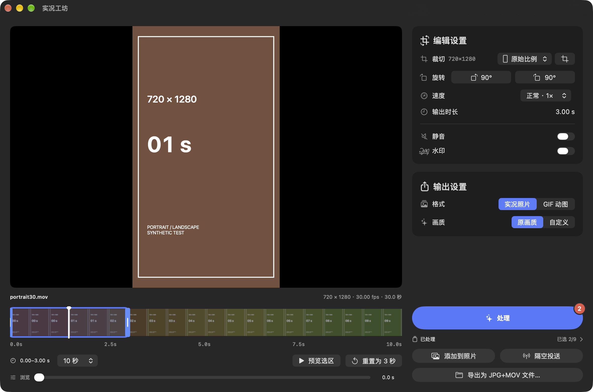

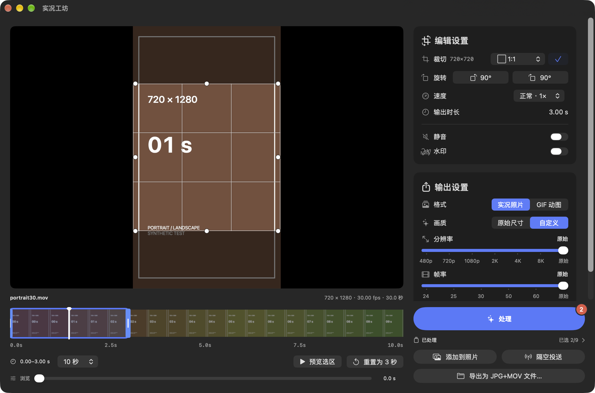

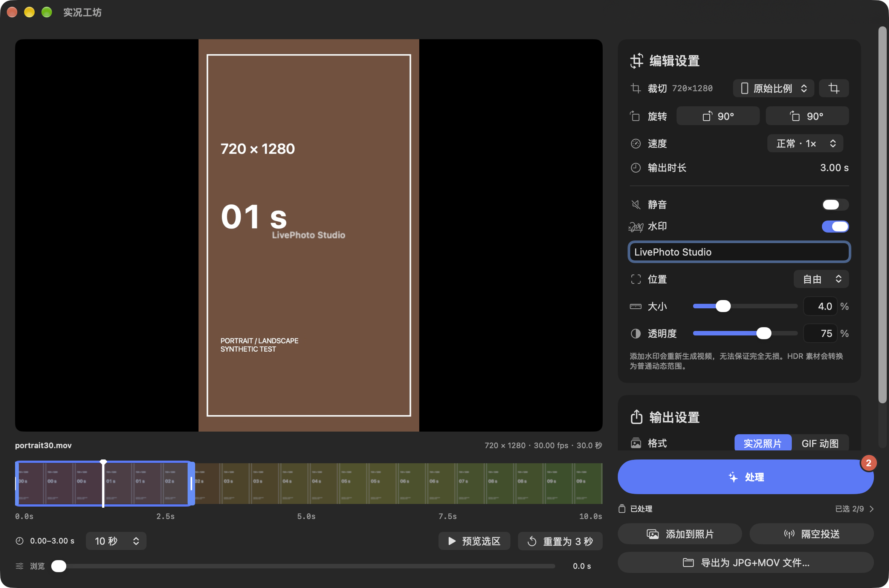

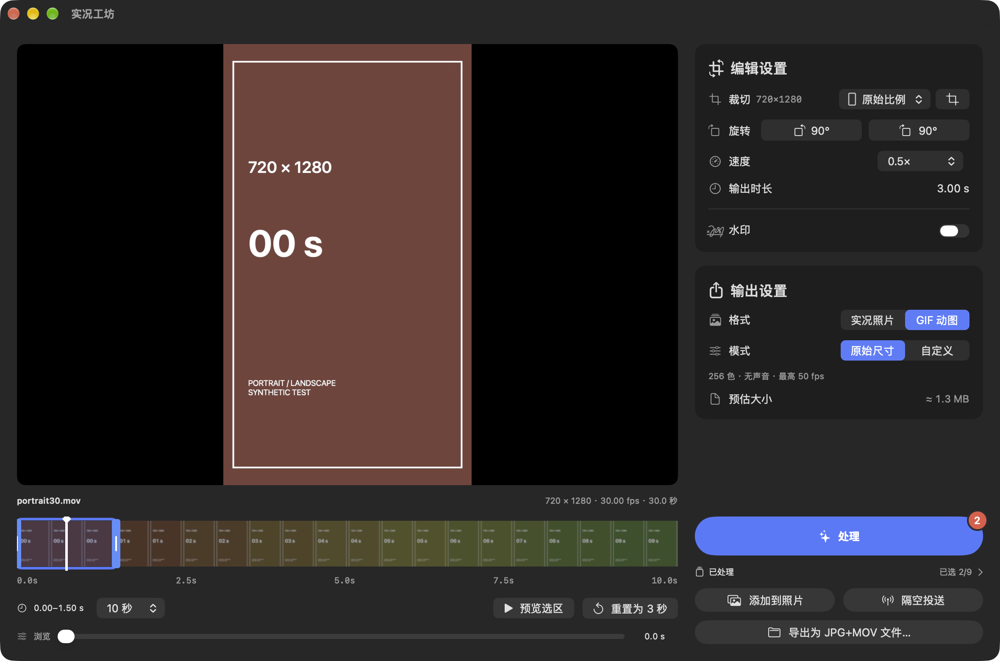

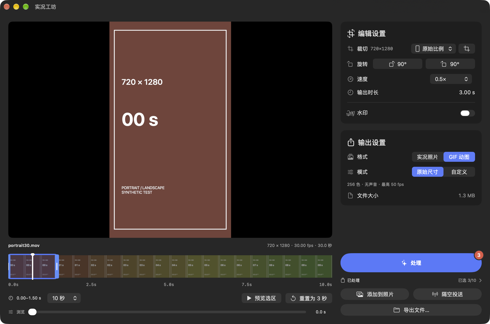

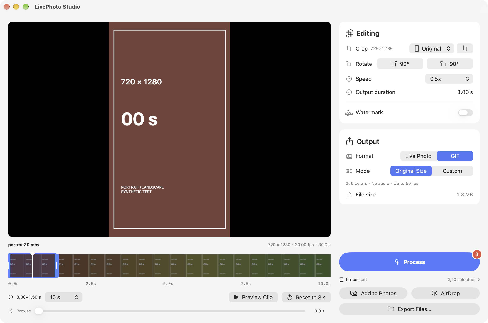

## 1.0 · 首次公开版本

### 项目介绍

实况工坊是一个原生 macOS 视频处理工具，用于将视频片段制作成实况照片或 GIF。项目以本机处理为主，不依赖外部运行时服务。

### 已实现功能

- 视频拖放导入、时间轴选段和封面选择。
- 实况照片和 GIF 输出。
- 常见比例裁切、自由裁切、左右 90° 旋转和水印。
- 原始尺寸优先，以及可选的输出分辨率和帧率。
- 添加到照片、隔空投送、JPG + MOV 文件导出。
- Finder 一级右键入口、简体中文／English、浅色／深色外观和首次使用引导。

### 下载与安装

- 下载 [LivePhotoStudio-1.0-universal.dmg](https://github.com/latter404/LivePhotoStudio/releases/download/v1.0/LivePhotoStudio-1.0-universal.dmg)，打开后将「实况工坊.app」拖入「应用程序」。
- 源码包为 [LivePhotoStudio-1.0-source.zip](https://github.com/latter404/LivePhotoStudio/releases/download/v1.0/LivePhotoStudio-1.0-source.zip)，校验值见 Release 附件中的 `SHA256SUMS.txt`。
- 支持 macOS 14+、Apple 芯片与 Intel；当前包为 ad-hoc 签名，尚未使用 Apple Developer ID 签名与公证。

### 验证范围

- 自动测试覆盖 Live Photo 配对、时间范围、裁切、旋转、水印、输出文件和失败清理。
- 构建流程检查通用包、Finder 扩展、资源和签名状态。
- 首次公开版本完成 Live Photo 配对、时间范围、画面处理、输出文件和构建流程验证。

## English

### 1.7.1 · Collage, batch actions, and interface guidance

**Changes:** Live Photo collage with draggable ordering, selectable audio source, grid preview, resolution, frame rate, and duration controls; multi-select, batch export, Photos, AirDrop, delete, and collage actions in Processed; one-time feature guidance; automatic high-quality fallback for source codecs that cannot be stream-copied; and layout and preview refinements.

**Download and install:** download [LivePhotoStudio-1.7.1.zip](https://github.com/latter404/LivePhotoStudio/releases/download/v1.7.1/LivePhotoStudio-1.7.1.zip), extract it, and drag the app into Applications. The source archive is [LivePhotoStudio-1.7.1-source.zip](https://github.com/latter404/LivePhotoStudio/releases/download/v1.7.1/LivePhotoStudio-1.7.1-source.zip); checksums are provided in `SHA256SUMS.txt`. The package supports macOS 14+, Apple silicon, and Intel. It is ad-hoc signed and not notarized.

**Validation scope:** automated tests report 118 passed, 1 skipped, and 0 failures. The universal package, Finder extension, resources, signing status, and installation were checked. Validation covers landscape and portrait video, timeline selection, Live Photo and GIF output settings, the processed list, native preview, and Live Photo collage.

### 1.7 · Collage, batch actions, and interface cleanup

**Changes:** clearer Process, Photos, AirDrop, Export, and Processed actions; batch selection and collage with draggable ordering; selectable audio source for collages; draggable image watermarks; and the existing crop, rotate, mute, GIF, frame-rate, resolution, and Finder entry workflows.

**Download and install:** download [LivePhotoStudio-1.7.zip](https://github.com/latter404/LivePhotoStudio/releases/download/v1.7/LivePhotoStudio-1.7.zip), extract it, and drag the app into Applications. It supports macOS 14+, Apple silicon, and Intel. The package is ad-hoc signed and not notarized.

**Validation scope:** automated tests cover pairing metadata, timing, speed, GIF estimates, crop, rotation, watermarks, batch results, file export, and failure cleanup. The universal build workflow checks the app bundle, Finder extension, resources, signing, and runtime dependencies. Public screenshots cover the editor, output settings, processed list, and collage interface.

### 1.1 · Speed, precise duration, and GIF estimates

**Changes:** synchronized trim-edge previews; 0.25×–4× speed; a three-second default output; custom duration by dragging either edge; sampled GIF size estimates and actual sizes; and the GitHub project link in About.

**Download and install:** download [LivePhotoStudio-1.1-universal.dmg](https://github.com/latter404/LivePhotoStudio/releases/download/v1.1/LivePhotoStudio-1.1-universal.dmg), quit the previous version, and replace it in Applications. The package supports macOS 14+, Apple silicon, and Intel, and is ad-hoc signed.

**Validation scope:** automated tests cover precise timing, passthrough ranges, speed, audio, GIF duration and estimates, default and custom duration, short clips, stored results, cancellation, and error recovery. Public screenshots cover the Chinese dark UI, English light UI, crop, custom output, watermarks, and GIF estimates. Validation uses reproducible media and the local build workflow.

### 1.0 · First public release

**Project:** a native macOS tool for turning video clips into Live Photos or GIFs, with local-first processing.

**Implemented:** drag-and-drop import, timeline trimming, cover selection, Live Photo and GIF output, crop, 90° rotation, watermarks, original-size preference, custom output settings, Photos, AirDrop, paired JPG + MOV export, Finder entry, Simplified Chinese/English, light/dark appearance, and first-use guidance.

**Download and install:** download [LivePhotoStudio-1.0-universal.dmg](https://github.com/latter404/LivePhotoStudio/releases/download/v1.0/LivePhotoStudio-1.0-universal.dmg), open it, and drag the app into Applications. The source archive and `SHA256SUMS.txt` are also provided. The package supports macOS 14+, Apple silicon, and Intel, and is ad-hoc signed.

**Validation scope:** automated tests cover Live Photo pairing, timing, crop, rotation, watermarks, output files, and failure cleanup. The build workflow checks the universal package, Finder extension, resources, and signing status. The first public release covers Live Photo pairing, timing, image processing, output files, and the build workflow.
