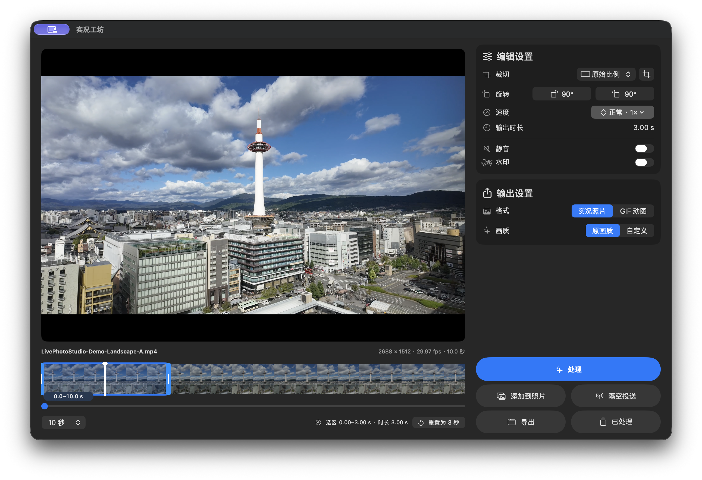
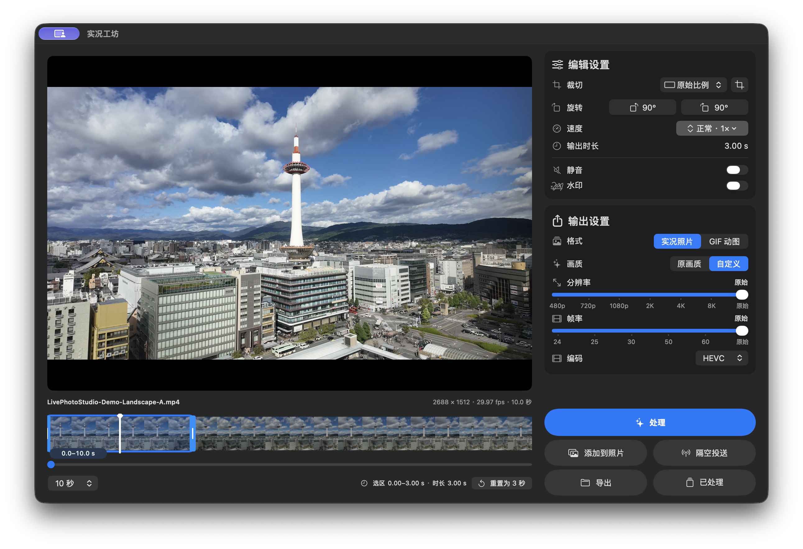
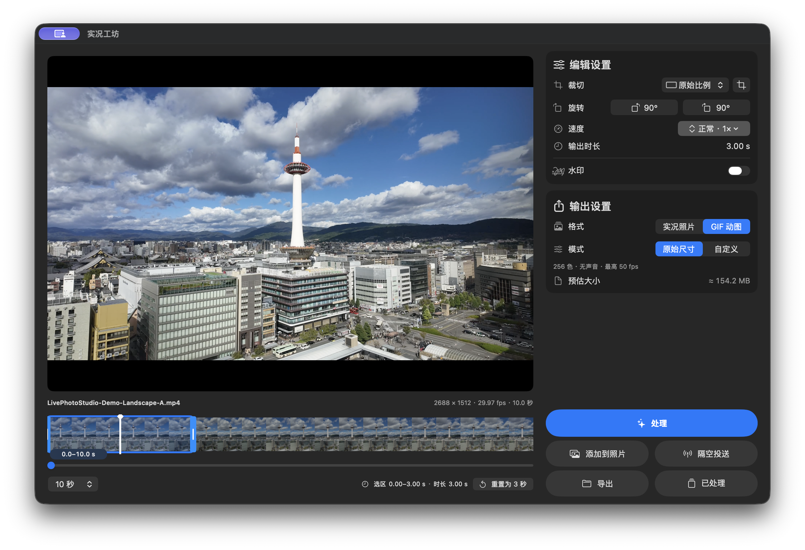
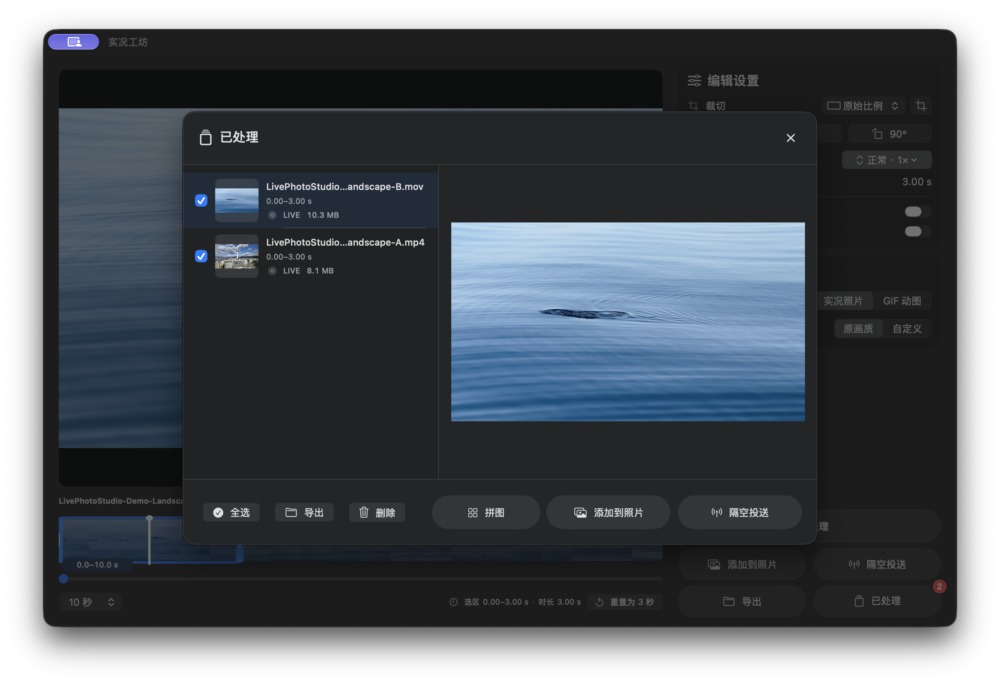
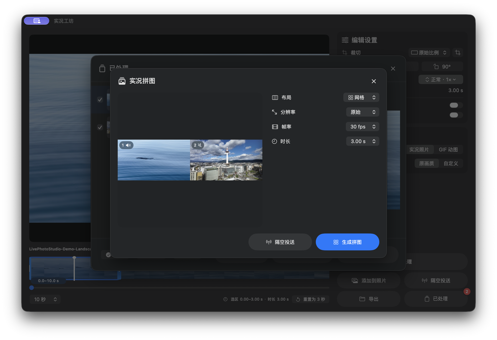

# 实况工坊版本说明

本文件按版本记录更新内容、安装方式、验证范围和界面变化。对应版本的安装包、源码包与 `SHA256SUMS.txt` 会随 GitHub Release 一起提供。

## 1.7.1

### 更新内容

- 新增实况拼图：支持 2–9 张实况照片、拖动排序、选择保留声音的照片、网格预览，以及分辨率、帧率和时长设置。
- 「已处理」支持多选、全选／取消全选、拼图、导出、删除，以及批量添加到「照片」和隔空投送。
- 主界面继续支持时间轴选区、封面选择、常见比例与自由裁切、左右 90° 旋转、静音、文字水印、图片水印、GIF 和实况照片输出。
- 输出设置默认保留原始尺寸，并支持自定义分辨率、24／25／30／50／60 fps、H.264 和 HEVC。
- 对无法直接封装的源编码自动切换到高质量转码流程；说明通过控件帮助提示提供，不再占用常驻布局。
- 统一同级控件的高度、图标、对齐方式和重点操作样式；拼图、已处理列表和错误提示使用一致的关闭与反馈交互。
- 主界面和拼图界面支持点击预览播放／暂停，并优化最小窗口尺寸与右侧操作区布局。

### 下载与安装

- 从 [GitHub Releases](https://github.com/latter404/LivePhotoStudio/releases) 下载对应版本的安装包，解压后将「实况工坊.app」拖入「应用程序」。
- 支持 macOS 14+、Apple 芯片与 Intel；运行时不需要额外安装 FFmpeg、Python、Homebrew 或 Xcode。
- 当前包为 ad-hoc 签名，尚未使用 Apple Developer ID 签名与公证；首次打开可能出现 macOS 来源验证提示。

### 验证范围

- `swift test --quiet`：118 项通过、1 项可选高分辨率夹具跳过、0 项失败。
- 完成 Apple 芯片／Intel 通用包构建、应用包审计、资源检查、Finder 扩展检查和本机安装验证。
- 界面检查覆盖编辑器、输出设置、GIF 设置、已处理列表和双横屏实况拼图。
- 4K／8K 选项和多种输出路径已纳入自动化与构建检查；具体素材的耗时与兼容性仍取决于源文件和系统资源。

### 界面截图

## 1.7

### 更新内容

- 将「处理」「添加到照片」「隔空投送」「导出」和「已处理」分成清晰的操作层级。
- 「已处理」支持全选、拼图、导出所选、删除，以及批量添加到照片和隔空投送。
- 拼图支持直接拖动图片排序，并可指定保留哪一张图片的声音。
- 图片水印支持直接拖动，调整大小和透明度，并改善预览响应。
- 保留视频剪辑、裁切、旋转、静音、文字水印、GIF、帧率、分辨率和 Finder 一级右键入口。

### 下载与安装

- 从 [GitHub Releases](https://github.com/latter404/LivePhotoStudio/releases) 下载 1.7 安装包，解压后将「实况工坊.app」拖入「应用程序」。
- 支持 macOS 14+、Apple 芯片与 Intel；运行时不需要额外安装 FFmpeg、Python、Homebrew 或 Xcode。
- 当前包为 ad-hoc 签名，尚未使用 Apple Developer ID 签名与公证；首次打开可能出现 macOS 来源验证提示。

### 验证范围

- 自动测试覆盖 Live Photo 配对元数据、时间范围、变速、GIF 估算、裁切、旋转、水印、批量结果、文件导出和失败清理。
- 通用构建流程检查 Apple 芯片／Intel 包、Finder 扩展、签名、资源和运行依赖。
- 公开界面截图覆盖编辑器、输出设置、已处理列表和实况拼图界面；4K／8K 选项不等同于所有素材组合都经过完整导出验证。

## 1.1

### 更新内容

- 时间轴两端拖动都会预览对应画面，直接封装按选区控制播放范围。
- 新增 0.25×–4× 播放速度；默认最终播放时长不超过 3 秒。
- 拖动选区两端可以自定义时长；「重置为 3 秒」恢复默认行为。
- GIF 处理前显示采样体积预估，处理后显示实际大小。
- 「关于」加入 GitHub 项目链接，并修复菜单语言切换后的显示问题。

### 下载与安装

- 从 [GitHub Releases](https://github.com/latter404/LivePhotoStudio/releases) 下载 1.1 安装包，退出旧版后将应用拖入「应用程序」。
- 支持 macOS 14+、Apple 芯片与 Intel；运行时不需要额外安装 FFmpeg、Python 或 Homebrew。
- 当前包为 ad-hoc 签名，尚未使用 Apple Developer ID 签名与公证。

### 验证范围

- 自动测试覆盖精确剪切、首尾帧、直接封装、变速、声音、GIF 时长与体积、默认三秒、手动时长、短素材、历史存储、取消和错误恢复。
- 公开界面截图覆盖中文深色、英文浅色、裁切、自定义输出、水印、GIF 体积预估和处理后大小。
- 验证使用可复现的媒体和本地构建流程。

## 1.0

### 项目介绍

实况工坊是一个原生 macOS 视频处理工具，用于将视频片段制作成实况照片或 GIF。项目以本机处理为主，不依赖外部运行时服务。

### 已实现功能

- 视频拖放导入、时间轴选段和封面选择。
- 实况照片和 GIF 输出。
- 常见比例裁切、自由裁切、左右 90° 旋转和水印。
- 原始尺寸优先，以及可选的输出分辨率和帧率。
- 添加到照片、隔空投送、JPG + MOV 文件导出。
- Finder 一级右键入口、简体中文／English、浅色／深色外观和首次使用引导。

### 下载与安装

- 从 [GitHub Releases](https://github.com/latter404/LivePhotoStudio/releases) 下载 1.0 安装包，打开后将「实况工坊.app」拖入「应用程序」。
- 支持 macOS 14+、Apple 芯片与 Intel；当前包为 ad-hoc 签名，尚未使用 Apple Developer ID 签名与公证。

### 验证范围

- 自动测试覆盖 Live Photo 配对、时间范围、裁切、旋转、水印、输出文件和失败清理。
- 构建流程检查通用包、Finder 扩展、资源和签名状态。
- 首次公开版本完成 Live Photo 配对、时间范围、画面处理、输出文件和构建流程验证。
